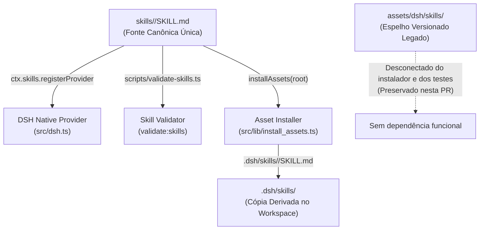

# Mapa de Fontes e Consumidores das Skills DSH (#40, #42)

## 1. Visão Geral e Autoridade Arquitetural

Este documento estabelece o mapa canônico de proveniência, instalação, testes e consumo das oito skills acadêmicas nativas do **DSHbanca** (referente às issues [#40](https://github.com/Base-Analitica/DSHbanca/issues/40), [#42](https://github.com/Base-Analitica/DSHbanca/issues/42) e [#23](https://github.com/Base-Analitica/DSHbanca/issues/23)).

O **DeepSeek Harness (DSH)** é o único harness suportado. O plugin acadêmico integra-se nativamente ao DSH através do framework **Cordis**.

### Rota Canônica Única

A árvore de diretórios canônica e editável das oito skills é:

```text
<packageRoot>/skills/<nome>/SKILL.md
```

Essa pasta é declarada em `package.json.files` e distribuída junto com o pacote. Ela constitui a **única fonte da verdade** para a definição, validação e instalação das skills.



## 2. Inventário Completo de Consumidores e Referências

Todas as referências às oito skills no repositório foram inventariadas e categorizadas conforme a governança arquitetural:

### 1. Fonte Canônica
- `<packageRoot>/skills/<nome>/SKILL.md`: Fonte única autoritativa, editável e versionada para as 8 skills acadêmicas. Declarada em `package.json.files`.

### 2. Consumidores Efetivos
- `src/dsh.ts`: Registra `ctx.skills.registerProvider` descobrindo `<packageRoot>/skills` em runtime e fornecendo os metadados e conteúdo diretamente ao serviço de skills do DSH.
- `src/lib/install_assets.ts`: Lê diretamente `<packageRoot>/skills/<nome>/SKILL.md` como fonte canônica para validar e instalar as skills no workspace.
- `scripts/validate-skills.ts`: CLI executado em `bun run validate:skills` que consome por padrão `process.env.SKILLS_DIR || "skills"`.
- `src/lib/skill_validator.ts`: Módulo de validação com parser YAML estrito e contrato formal de frontmatter consumido pelo CLI e pelo instalador.
- `scripts/lib/dsh-profile-e2e-contract.ts`: Especificação do contrato de teste E2E nativo que valida as 8 skills canônicas em `skills/<nome>/SKILL.md`.

### 3. Cópia Derivada
- `<projectRoot>/.dsh/skills/<nome>/SKILL.md`: Cópia derivada gerada no workspace do usuário por `installAssets()` a partir da fonte canônica.

### 4. Fixtures Sintéticas
- `tests/skills.test.ts`: Fixtures temporárias criadas em diretórios descartáveis (`tempDir`) para testar isolamento, permissões, symlinks, empacotamento offline e ausência do espelho.

### 5. Referências Documentais ou Históricas
- `assets/dsh/skills/`: Espelho legado versionado. **Preservado fisicamente no repositório nesta PR**, mas 100% desconectado do runtime do instalador e da suíte de testes automatizados.
- `docs/dsh-skill-source-map.md`: Mapeamento arquitetural de proveniência e governança.

## 3. As Oito Skills Nativas e Hashes SHA-256

Todas as oito skills possuem integridade comprovada byte a byte entre a fonte canônica e o espelho mantido:

| Skill | Nome Declarado | Finalidade Acadêmica | SHA-256 (Canônico) |
|---|---|---|---|
| `banca-avaliacao` | `banca-avaliacao` | Protocolo de auditoria exaustiva por lotes e síntese relacional global | `60bdcd97061da7748f7d1f9d6d7999fd62afac9b1269bf089eb23da7aab7c85e` |
| `banca-correcao` | `banca-correcao` | Aplica correções com snapshots, contratos e compilação | `d0a05d3feb78f5ef05615a48892b3c5cdc88fc589b3fc2100f2d78a0a32d45c7` |
| `banca-detector-ia` | `banca-detector-ia` | Triagem heurística não-conclusiva de padrões estilísticos | `db296d3e384e809847b2398638d55c2bcf62e092c2058943013a7523cb1b6a4b` |
| `banca-grille` | `banca-grille` | Entrevista com o autor para resolução de ambiguidades | `c22d6bd6598117c491176fd1366c9c3974104bc3a349ebe791b1051f79682aa1` |
| `banca-plagio` | `banca-plagio` | Tratamento e reescrita de trechos de relatórios de similaridade | `1159f65153fad06086fa0debefe41a567cf895d251b1dd4f52a2849ae1146661` |
| `banca-planejador` | `banca-planejador` | Planejamento da estratégia de correções por prioridade | `d39405b0333e53eabd616104d4387dd0f77c26d505d63bed9094a8ae254eac64` |
| `banca-referencias` | `banca-referencias` | Validação de referências bibliográficas contra bases acadêmicas | `b5b73abbbae029adc82980b2045c705b091b1629a44d14efab92aa731008d36b` |
| `banca-revisor` | `banca-revisor` | Revisão do diff e bloqueio preventivo de regressões | `deb90fe58a8d334bddd9f4dc66810cb5c57621cc63bad313c44c199c042de798` |

## 4. Desacoplamento dos Testes do Espelho Legado (#42)

Na implementação da issue #42, as seguintes dependências físicas dos testes em relação a `assets/dsh/skills/` foram removidas:

1. **Validação Geral de Skills (`tests/skills.test.ts:49`)**:
   - Anterior: Executava `validateAllSkills(versionedSkillsDir)` incondicionalmente, falhando se o espelho legado não estivesse no disco.
   - Atual: O contrato de validação é exercitado contra a fonte canônica `skills/` e, se o espelho legado existir durante o período transitório, valida sua consistência sem falhar em caso de ausência física.
2. **Teste de Fallback (`tests/skills.test.ts:280–295`)**:
   - Anterior: Comparava as skills instaladas via fallback diretamente com os arquivos em `assets/dsh/skills/`.
   - Atual: Compara o conteúdo e os hashes SHA-256 instalados diretamente com a fonte canônica `skills/`, garantindo que o fallback instala as 8 skills canônicas exatas.
3. **Override da CLI (`tests/skills.test.ts:402–415`)**:
   - Anterior: Passava `SKILLS_DIR: join(repoRoot, "assets", "dsh", "skills")`.
   - Atual: Utiliza uma fixture sintética com skills válidas (`cliFixturesDir/synthetic-skills-override`), testando o override de `SKILLS_DIR` de forma autônoma.
4. **Negativo de YAML Corrompido no Preflight (`tests/skills.test.ts:747–770`)**:
   - Anterior: Dependia da asserção `expect(existsSync(join(versionedSkillsDir, ...))).toBe(true)`.
   - Atual: Constrói uma fixture sintética contendo um espelho válido em `customAssetsDir/dsh/skills` e comprova que o preflight continua fail-closed (rejeitando YAML malformado na fonte canônica e impedindo escritas no workspace sem ser mascarado pelo espelho).

## 5. Prova Hermética de Pacote sem Espelho (Caso L)

O Caso L de teste (`tests/skills.test.ts`) simula o cenário do pacote distribuível sem `assets/dsh/skills/`:
1. Gera o tarball via `npm pack --ignore-scripts --offline` e extrai em diretório isolado.
2. Remove fisicamente `assets/dsh/skills/` do pacote extraído.
3. Comprova que:
   - Todas as 8 skills canônicas estão íntegras em `skills/`.
   - O validador oficial aprova as 8 skills (0 erros).
   - O instalador instala normalmente no workspace (`.dsh/skills/`).
   - O fallback funciona mesmo sem pasta de assets.
   - Os hashes SHA-256 de todas as skills instaladas coincidem exatamente com os canônicos.
   - O runtime Node ESM resolve os módulos compilados e executa o parser YAML.
   - O pacote de produção não depende de `devDependencies` (`typescript` ou `@types`).
   - A ausência do espelho não dispara nenhum fallback silencioso para texto estático embutido (comprovado com conteúdo customizado dinâmico).
   - O processo de empacotamento opera com timeouts limitados (≤ 15s) e sob isolamento de rede (`unshare -Urn`).

## 6. Testes Negativos Preservados

A independência dos testes não reduziu a cobertura de casos negativos:
- **YAML sintaticamente inválido**: Rejeitado antes de qualquer escrita no workspace (em `src` e em `dist`).
- **Campos obrigatórios ausentes ou com formato divergente**: Validados e rejeitados no preflight.
- **Espelhos adulterados**: Testado no Caso D com espelho sintético corrompido, provando que o instalador ignora o espelho e usa exclusivamente a fonte canônica.
- **Symlinks maliciosos e evasão de diretório**: Rejeitados com bloqueio estrito.
- **Proteção contra sobrescrita**: Bloqueia modificação de skills customizadas no workspace, mesmo com `force: true`.

## 7. Procedimento de Reversibilidade e Futura Remoção

### Estado Atual (PR #42)
- **O espelho `assets/dsh/skills/` NÃO FOI REMOVIDO.** Permanece versionado no repositório.
- A exclusão definitiva depende de autorização humana formal posterior.

### Reversibilidade do Slice Atual
Caso seja necessária a reversão da PR #42:
```bash
git revert <commit-sha> --no-edit
bun run build
bun test
```
O teste automatizado em fixture (`tests/skills.test.ts` Caso I e Caso L) comprova restauração determinística sem alterar arquivos fora do sandbox de teste.

### Plano Reversível para Remoção Futura
Quando a governança autorizar a exclusão definitiva do espelho:
1. Executar a exclusão:
   ```bash
   git rm -r assets/dsh/skills
   git commit -m "chore(skills): remover espelho legado assets/dsh/skills (#42)"
   ```
2. Caso ocorra qualquer necessidade histórica de restaurar o espelho legado a partir do Git:
   ```bash
   git checkout e80d415d3a6490bb840349eb0a11c09ef1838f44 -- assets/dsh/skills
   ```
   Isso restaurará a pasta com integridade byte a byte idêntica aos hashes SHA-256 canônicos tabelados na Seção 3.

## 8. Distinção entre Testes Herméticos e E2E DSH Real

Conforme `AGENTS.md` e `docs/ai-review-protocol.md`:
- **Testes de Unidade e Empacotamento (Casos A a L)**: Testam hermeticamente a lógica de validação, empacotamento, importação ESM, preflight fail-closed e segurança de arquivos locais sem uso de rede, modelo ou credenciais.
- **E2E DSH Real (`scripts/e2e-dsh-profile.ts`)**: Executa a verificação no harness ativo DSH/Cordis. Permanece **BLOCKED / opt-in**, exigindo autorização humana explícita para cada novo SHA e nunca sendo inferido a partir de testes unitários ou CI.
