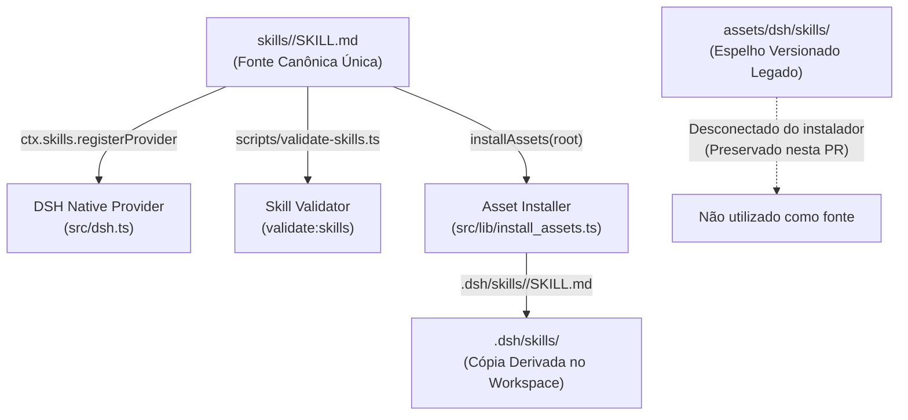

# Mapa de Fontes e Consumidores das Skills DSH (#40)

## 1. Visão Geral e Autoridade Arquitetural

Este documento estabelece o mapa canônico de proveniência, instalação e consumo das oito skills acadêmicas nativas do **DSHbanca** (referente às issues [#40](https://github.com/Base-Analitica/DSHbanca/issues/40) e [#23](https://github.com/Base-Analitica/DSHbanca/issues/23)).

O **DeepSeek Harness (DSH)** é o único harness suportado. O plugin acadêmico integra-se nativamente ao DSH através do framework **Cordis**.

### Rota Canônica Única

A árvore de diretórios canônica e editável das oito skills é:

```text
<packageRoot>/skills/<nome>/SKILL.md
```

Essa pasta é declarada em `package.json.files` e distribuída junto com o pacote. Ela constitui a **única fonte da verdade** para a definição, validação e instalação das skills.



## 2. Consumidores da Fonte Canônica

| Componente | Arquivo | Modo de Consumo |
|---|---|---|
| **Módulo Canônico de Validação** | `src/lib/skill_validator.ts` | Parser YAML integral e schema estrito de validação compartilhado entre CLI e instalador. |
| **DSH Skill Provider** | `src/dsh.ts` | Registra `ctx.skills.registerProvider` descobrindo `<packageRoot>/skills` em runtime e fornecendo os metadados e conteúdo diretamente ao serviço de skills do DSH. |
| **Validador de Skills** | `scripts/validate-skills.ts` | CLI re-exporta o contrato de `src/lib/skill_validator.ts` para validação em CI e build. |
| **Instalador de Assets** | `src/lib/install_assets.ts` | Valida integralmente com `validateSkillContent` e `validateAllSkills` antes de escrever cópias derivadas em `.dsh/skills/<nome>/SKILL.md` no workspace. |

### Espelho Versionado Legado (`assets/dsh/skills/`)

- O espelho em `assets/dsh/skills/` é mantido versionado no repositório nesta PR para preservar compatibilidade e integridade histórica.
- **O instalador foi completamente desconectado deste espelho:** nenhuma instalação lê de `assets/dsh/skills/`.
- A remoção do espelho será tratada em issue e PR futuras, após consolidação integral e homologação E2E.

### Eliminação de Duplicação Textual

- A constante `const SKILLS: Record<string, Record<string, string>>` embutida em `src/lib/install_assets.ts` (mais de 240 linhas de texto duplicado) foi **totalmente eliminada**.
- Tanto em instalação normal quanto em fallback sem diretório customizado de assets, o instalador consome exclusivamente `skills/`.

## 3. As Oito Skills Nativas e Tabela de Hashes SHA-256

Todas as oito skills possuem integridade comprovada byte a byte entre a fonte canônica e o espelho mantido:

| Skill | Nome Declarado | Finalidade Acadêmica | SHA-256 (Canônico e Espelho) |
|---|---|---|---|
| `banca-avaliacao` | `banca-avaliacao` | Protocolo de auditoria exaustiva por lotes e síntese relacional global | `60bdcd97061da7748f7d1f9d6d7999fd62afac9b1269bf089eb23da7aab7c85e` |
| `banca-correcao` | `banca-correcao` | Aplica correções com snapshots, contratos e compilação | `d0a05d3feb78f5ef05615a48892b3c5cdc88fc589b3fc2100f2d78a0a32d45c7` |
| `banca-detector-ia` | `banca-detector-ia` | Triagem heurística não-conclusiva de padrões estilísticos | `db296d3e384e809847b2398638d55c2bcf62e092c2058943013a7523cb1b6a4b` |
| `banca-grille` | `banca-grille` | Entrevista com o autor para resolução de ambiguidades | `c22d6bd6598117c491176fd1366c9c3974104bc3a349ebe791b1051f79682aa1` |
| `banca-plagio` | `banca-plagio` | Tratamento e reescrita de trechos de relatórios de similaridade | `1159f65153fad06086fa0debefe41a567cf895d251b1dd4f52a2849ae1146661` |
| `banca-planejador` | `banca-planejador` | Planejamento da estratégia de correções por prioridade | `d39405b0333e53eabd616104d4387dd0f77c26d505d63bed9094a8ae254eac64` |
| `banca-referencias` | `banca-referencias` | Validação de referências bibliográficas contra bases acadêmicas | `b5b73abbbae029adc82980b2045c705b091b1629a44d14efab92aa731008d36b` |
| `banca-revisor` | `banca-revisor` | Revisão do diff e bloqueio preventivo de regressões | `deb90fe58a8d334bddd9f4dc66810cb5c57621cc63bad313c44c199c042de798` |

## 4. Garantias de Segurança no Preflight

Antes de escrever qualquer arquivo ou criar diretórios no workspace do usuário, `installAssets()` executa verificações fail-closed:

1. **Validação da Raiz Canônica**:
   - Confirmação de existência e que `<packageRoot>/skills` é um diretório real e regular.
   - Rejeição de symlinks perigosos ou caminhos que escapem à raiz do pacote.
2. **Validação Exaustiva das 8 Skills via Contrato Canônico (`src/lib/skill_validator.ts`)**:
   - Exige a presença de todos os 8 diretórios obrigatórios.
   - Exige que cada `SKILL.md` seja um arquivo regular (não symlink e não diretório).
   - Valida integralmente a sintaxe YAML do frontmatter com parser completo (rejeitando sequências não terminadas, nós inválidos e formatações malformadas).
   - Valida tipagem e regras estritas: `name` correspondente ao diretório e regex `^[a-z0-9]+(-[a-z0-9]+)*$`, `description` não-vazia (entre 1 e 1024 caracteres), campos opcionais `license`, `compatibility` e dicionário `metadata` com valores string.
   - Rejeita qualquer duplicação de nomes de skills no diretório canônico antes de qualquer escrita.
3. **Contenção e Destino Seguro**:
   - `resolveRealInsideRoot` valida contenção estrita dentro do workspace (`projectRoot`).
   - Bloqueio se `.dsh`, `.banca` ou `.dsh/skills` forem symlinks ou apontarem para fora.
4. **Pacote de Assets Incompleto**:
   - Quando `customAssetsDir` é informado e existe, o instalador verifica preventivamente a presença de todos os agentes e comandos obrigatórios.
   - Se faltar qualquer componente, a operação falha com erro descritivo antes de qualquer alteração no workspace.
5. **Proteção Contra Sobrescrita de Dados e Drift**:
   - Se um arquivo de skill já existir no workspace e seu conteúdo diferir do canônico, o instalador rejeita a execução.
   - O argumento `force: true` **não** autoriza a destruição ou substituição de arquivos customizados pelo usuário.
   - Skills próprias ou customizadas pelo usuário no workspace são integralmente preservadas.

## 5. Procedimento de Reversibilidade

Caso seja necessária a reversão deste slice em um ambiente:

1. **Auditoria de Estado**:
   - Registrar o inventário de arquivos e fingerprints em `.dsh/skills/*/SKILL.md`.
2. **Reversão do Commit via Git**:
   ```bash
   git revert <commit-sha> --no-edit
   ```
3. **Recompilação e Validação**:
   ```bash
   bun run build
   bun test
   ```
4. **Verificação de Restauração**:
   - O teste automatizado de reversibilidade em fixture (`tests/skills.test.ts` caso I) comprova que o estado anterior é restaurado determinística e integralmente.
   - Nenhum arquivo de projeto real ou manuscrito de usuário é alterado durante o rollback.

## 6. Distinção entre Registry e Execução de Modelo

Conforme `AGENTS.md` e `docs/ai-review-protocol.md`:
- O carregamento, registro (`ctx.skills.registerProvider`) e recuperação (`ctx.skills.get`) referem-se à infraestrutura Cordis/DSH.
- A aplicação heurística ou interpretação de instruções do Markdown por um modelo de IA é um comportamento dependente de inferência, que exige autorização pontual e não é provado por CI, build ou testes locais.
